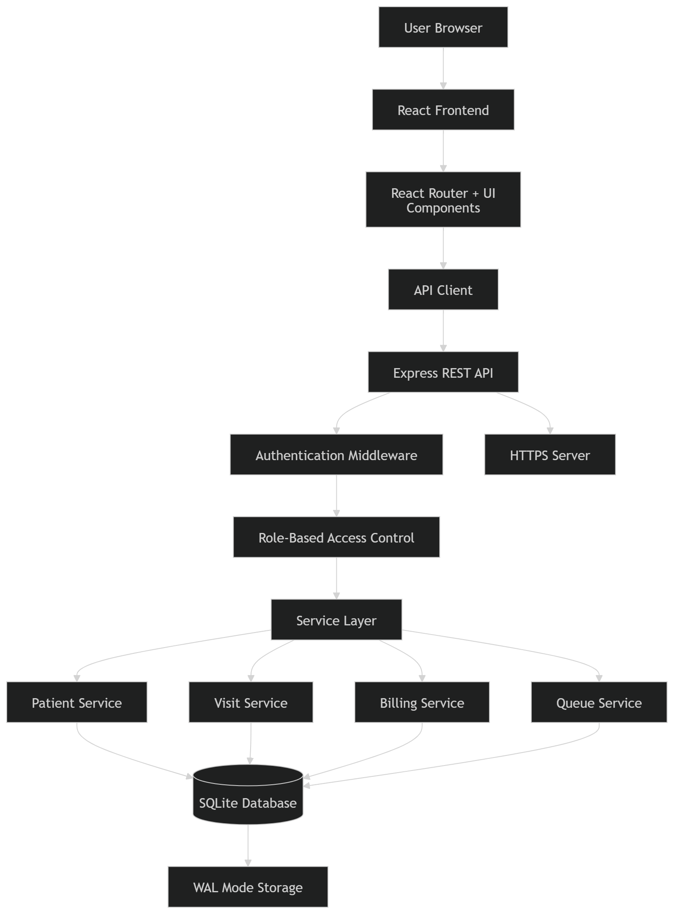
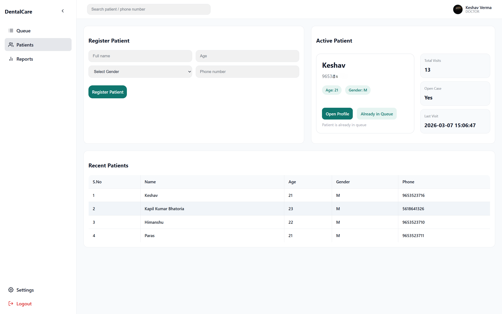
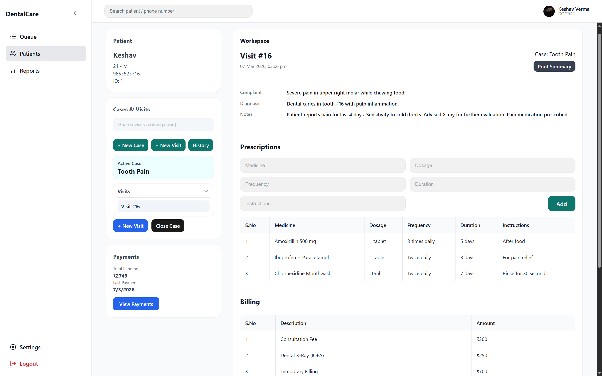
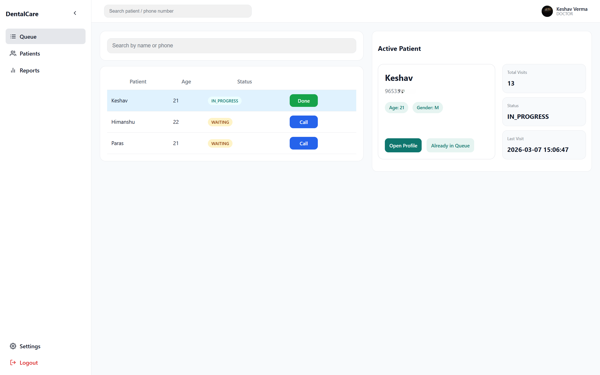
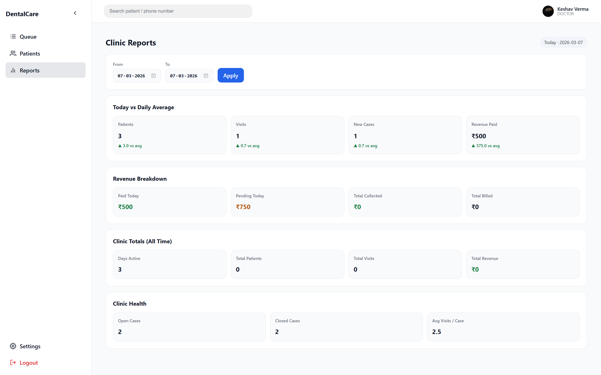

---

# 🏥 Clinic Management System

<p align="center">
  <b>A Full-Stack Clinic Workflow Platform for Patient Records, Visits, Prescriptions, Billing and Queue Management</b>
</p>

<p align="center">


</p>

---

# 📌 Overview

The **Clinic Management System (CMS)** is a full-stack healthcare workflow application designed to **digitize and organize clinic operations**.

It replaces traditional manual workflows with a **structured digital platform** that manages patients, visits, prescriptions, billing, and queue management.

The system provides:

* Patient registration & tracking
* Case-based visit management
* Prescription tracking
* Billing & payment system
* Queue workflow
* Role-based access control
* Visit history tracking
* Printable visit summaries
* Secure HTTPS backend

The project follows a **modular full-stack architecture designed for real-world scalability**.

---

# 🧠 Problem Statement

Small and medium clinics often face issues such as:

* Paper prescriptions
* Manual patient registers
* No visit history
* Poor billing tracking
* No queue visibility
* Lack of role separation

This system solves these problems by creating a **centralized clinic workflow engine** that manages medical and financial records securely.

---

# 🚀 Features

### Patient Management

* Patient registration
* Fast patient search
* Patient history tracking

### Case & Visit Management

* Case-based visit grouping
* Visit diagnosis & notes
* Structured medical records

### Prescriptions

* Medicine tracking
* Dosage & instructions
* Visit-linked prescriptions

### Billing & Payments

* Visit-level billing
* Partial payment support
* Payment history

### Queue System

* Real-time queue management
* Doctor workflow integration

### Role-Based Access

* Admin
* Doctor
* Staff

### Print System

* Visit summary printing
* Prescription formatting

---

# 🏗 System Architecture

## Frontend

* React (Functional Components)
* Vite
* React Router
* Context API
* Role-based route guards
* Responsive canvas layout

## Backend

* Node.js
* Express.js
* RESTful API
* JWT authentication
* Role-based middleware
* Modular service architecture

## Database

* SQLite
* WAL mode for concurrency
* Migration-based schema system

---

# 🧭 System Architecture Diagram

<p align="center">

</p>

Architecture Flow:

```
User (Browser)
      ↓
React Frontend
      ↓
API Client
      ↓
Express REST API
      ↓
Auth + RBAC Middleware
      ↓
Service Layer
      ↓
SQLite Database
```

This architecture ensures:

* clear separation of layers
* secure access control
* modular backend services
* reliable data persistence

---

# 🖼 Application Screenshots

### Patient Management

<p align="center">

</p>

---

### Patient Profile

<p align="center">

</p>

---

### Queue Management

<p align="center">

</p>

---

### Reports Dashboard

<p align="center">

</p>

---

# 🗃 Database Design

Relational structure used in the system:

```
Patient → Case → Visit
Visit → Prescriptions
Visit → Billing → Payments
```

Database migrations are stored in:

```
server/db/migrations/
```

---

# 🎨 UI Design System

The UI uses a **two-column canvas layout architecture**.

```
Left  → Navigation / Case Manager
Right → Workspace
```

Features include:

* single global scroll
* responsive layout
* tablet overlay sidebar
* mobile stacked layout
* print-friendly UI

---

# ⚙️ Tech Stack

| Layer        | Technology            |
| ------------ | --------------------- |
| Frontend     | React                 |
| Bundler      | Vite                  |
| Backend      | Node.js               |
| Framework    | Express               |
| Database     | SQLite                |
| Auth         | JWT                   |
| Security     | HTTPS                 |
| Architecture | Modular Service Layer |

---

# 🚀 Getting Started

## Clone Repository

```
git clone https://github.com/YOUR_USERNAME/clinic-management-system.git
cd clinic-management-system
```

---

## Install Dependencies

### Frontend

```
cd client
npm install
```

### Backend

```
cd ../server
npm install
```

---

## Environment Setup

Create `.env` inside `server/`

```
PORT=8443
JWT_SECRET=your_secret_here
DATA_DIR=./data
```

---

## Run Development Mode

### Backend

```
npm run dev
```

### Frontend

```
cd ../client
npm run dev
```

---

# 🔐 SSL Certificate (Development)

Generate a self-signed certificate:

```
cd server/scripts
generate-ssl.bat
```

Certificates are **not stored in the repository for security reasons**.

---

# 📂 Project Structure

```
client/
 ├── src/
 └── public/

server/
 ├── routes/
 ├── services/
 ├── db/
 ├── auth/
 ├── crypto/
 └── config/
```

---

# 📈 Production Deployment

The system supports:

* HTTPS backend
* SQLite WAL mode
* Windows Service deployment
* Installer-based distribution

*(Installer is not included in this repository)*

---

# 🛡 Security Notes

Sensitive files excluded from repository:

* `.env`
* SSL certificates
* database files
* backups
* logs

---

# 💼 Portfolio Summary

Developed a **full-stack Clinic Management System** using React and Node.js with **role-based access control, queue workflow, visit tracking, billing/payment integration, and secure HTTPS backend deployment**.

---

# 👨‍💻 Author

**Keshav Verma**
B.Tech CSE
Full-Stack Developer

---

# ⭐ Support

If you like this project, consider giving it a **star ⭐ on GitHub**.

---
